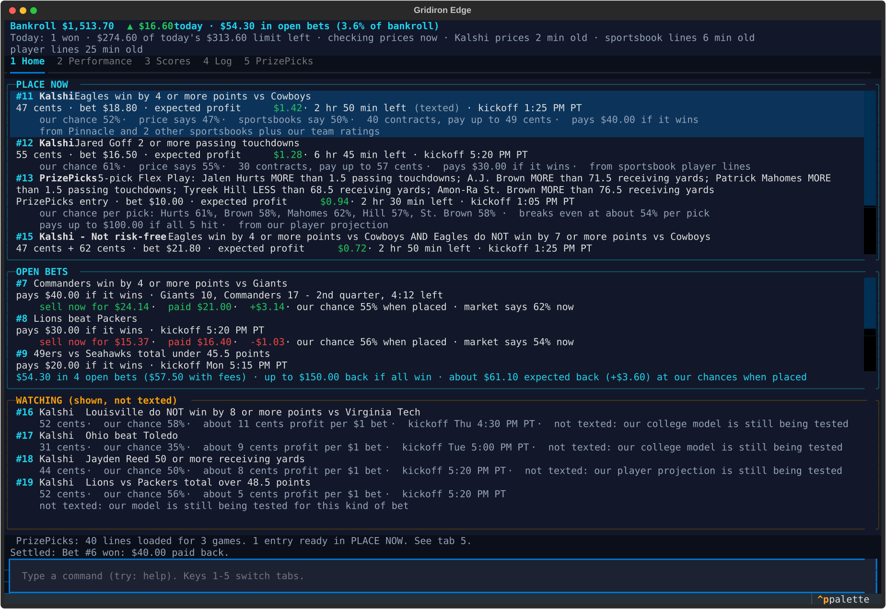
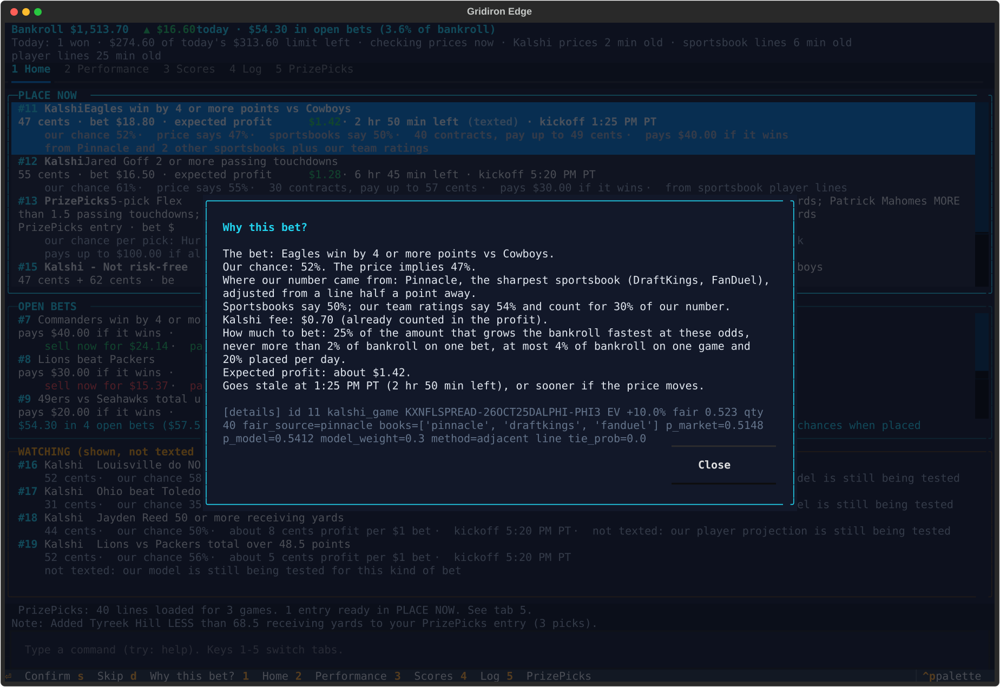
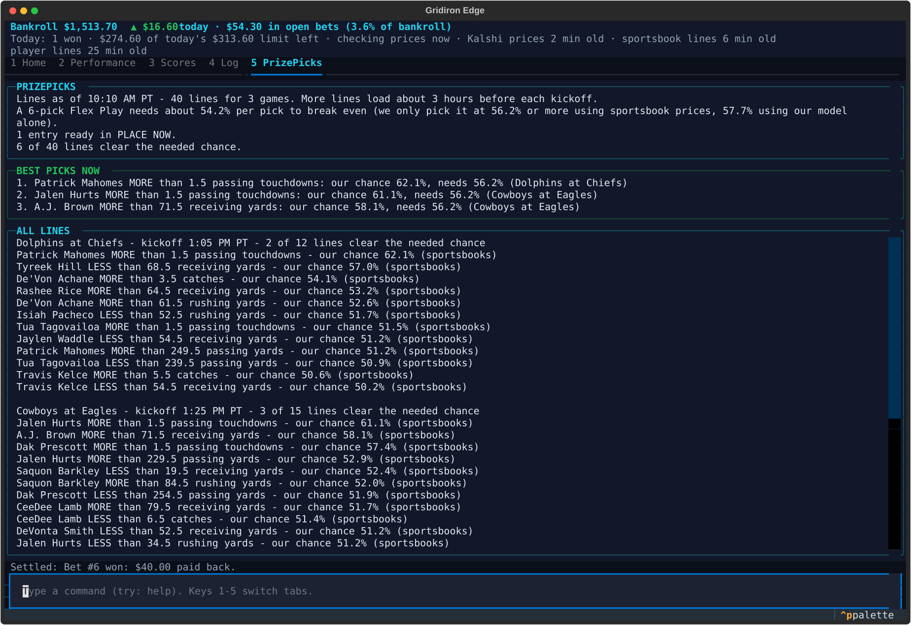
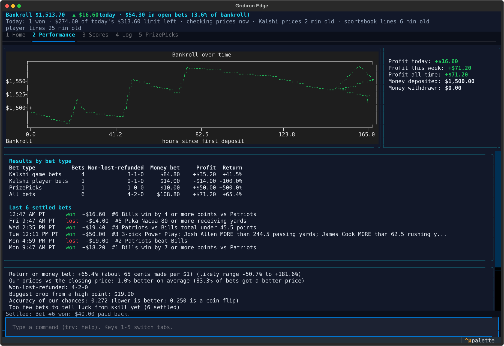
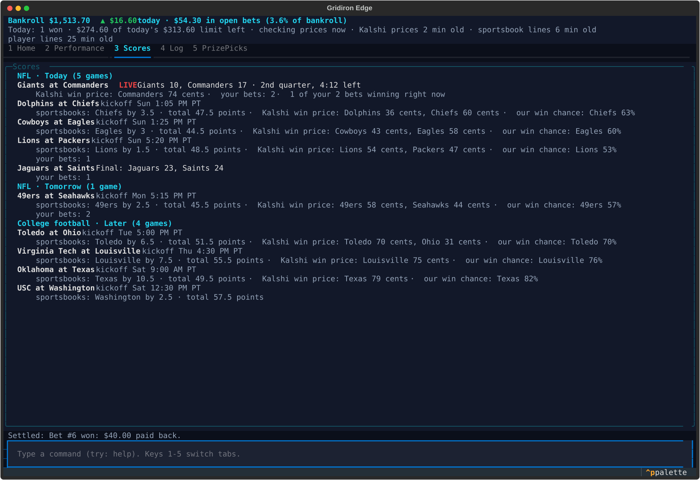
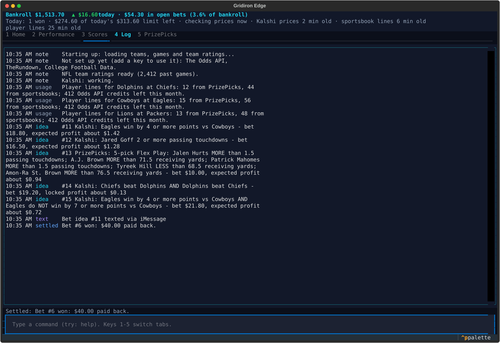
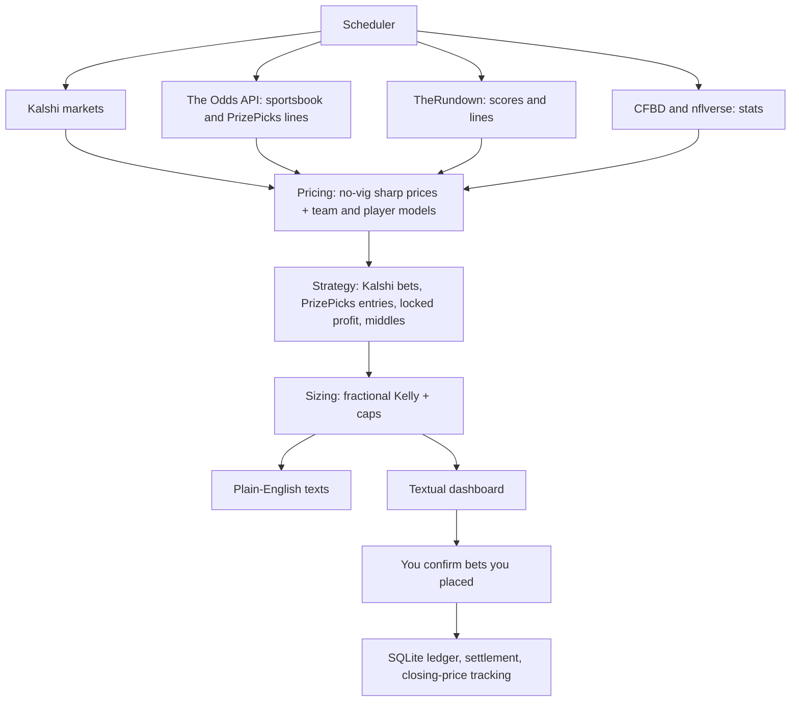

# Gridiron Edge


Gridiron Edge is a terminal app that finds football bets worth making on Kalshi and PrizePicks, texts
them to you in plain English, and tracks your bankroll. It prices every bet against sharp sportsbook
lines and its own NFL and college football models, sizes stakes with fractional Kelly, and checks
every "locked profit" pair against every possible final score.
It never places bets and never logs in to Kalshi or PrizePicks: you place a bet yourself, then confirm
it in the app so the ledger matches.

---

## Table of Contents

- [Features](#features)
- [Demo](#demo)
- [Project Story](#project-story)
- [Results & Impact](#results--impact)
- [Tech Stack](#tech-stack)
- [Architecture](#architecture)
- [Getting Started](#getting-started)
- [Usage](#usage)
- [Folder Structure](#folder-structure)
- [Author](#author)
- [Acknowledgments](#acknowledgments)

---

## Features

- **Place-now list:** only bets you can still make: market open, before kickoff, and still worth it
  after fees. Each shows our chance against the price's chance, the stake, the expected profit and how
  long it stays good.
- **Plain-English texts:** one text per idea through Messages.app, rate-limited, ending with the
  command to confirm it.
- **Sharp pricing:** no-vig Pinnacle and other sharp books, shifted to Kalshi's lines and pulled toward
  Kalshi's own price the further the line is from the sportsbooks'.
- **Team and player models:** NFL and college ratings plus a player-yardage projector, blended in only
  after they beat the market in walk-forward backtests (until then their ideas are shown, not texted).
- **PrizePicks (on Home):** loads lines for every game about 3 hours before kickoff and suggests
  the best 2- to 6-pick Power or Flex play of each size, ranked by long-run bankroll growth, each with
  a suggested buy-in from your bankroll limits. Same-game picks are scored at the worst case for how
  they move together. You can also pick lines yourself and see the entry's chances.
- **Locked profit and middles:** Kalshi pairs that pay back at least what they cost whatever the score,
  checked against every final score.
- **Risk controls:** quarter Kelly with per-bet, per-game, per-slate and daily caps; markets pause
  when recent results drift.
- **Tracking:** open bets with what they'd sell for now, live scores, closing-price comparison, return
  by bet type and a bankroll chart.

---

## Demo

Screenshots use sample data.

**Home:** bets to place now, PrizePicks plays and lines, open bets, and the watch list


**"Why this bet?"** (press `d` on a bet)


**PrizePicks:** ranked suggested plays with a buy-in, your own entry, and every loaded line


**Performance:** bankroll, returns by bet type, and how often our chances came true


**Scores:** sportsbook lines, Kalshi prices and your bets on each game


**Log**


---

## Project Story

I wanted to see what football betting looks like when it's done the way a quant desk would do it, on
free data, from a terminal. The rules were strict from the start: free API tiers only, no automated
betting, no scraping, and every number explained in words a casual fan can read. The project went
through a full quant audit (pricing, team models, player props, sizing, PrizePicks and arbitrage,
evaluation) and a live shakedown that caught real bugs, such as spread markets from opposite teams
being paired as "locked profit", which are now covered by payoff checks and regression tests.

---

## Results & Impact

- Runs entirely on free tiers: about 500 Odds API credits a month, with a budget guard on every call.
- Every "locked profit" idea is verified against every possible final score before it is shown.
- Model-only ideas stay watch-only until backtests show real skill, so nothing unproven gets texted.
- A pytest suite of roughly 800 tests, including a check that every text and screen stays in plain
  English.

---

## Tech Stack

**Data**:
- Kalshi public market data
- The Odds API (sportsbook and PrizePicks lines)
- TheRundown (scores and lines)
- CollegeFootballData (CFBD)
- nflverse (NFL stats)

**Modeling**:
- NumPy, SciPy, scikit-learn, Polars
- Ridge team ratings, logistic market/model blend, Gaussian-copula correlation, fractional Kelly

**App**:
- Python 3.14
- Textual and textual-plotext
- httpx, tenacity, aiolimiter
- SQLite (append-only ledger in integer cents)
- Messages.app via osascript, ntfy.sh as a backup

**Dev tools**:
- uv
- pytest, respx
- Git & GitHub

---

## Architecture

**Flow**:
- The scheduler pulls each source only as often as its free tier allows.
- Prices become chances: sharp sportsbook lines first, our models only where they have earned it.
- The strategy layer finds bets, PrizePicks entries and locked-profit pairs worth making after fees.
- Stakes are sized with quarter Kelly and capped per bet, game, slate and day.
- Ideas are texted once and shown on the dashboard; you confirm what you actually placed.
- Bets settle automatically, and each is compared with the closing price.

---

## Getting Started

1. Clone the repository
```bash
git clone https://github.com/cjr03/SportsBet.git
cd SportsBet
```
2. Install dependencies (needs [uv](https://docs.astral.sh/uv/) and Python 3.14)
```bash
uv sync
```
3. Add environment variables in `.env` (copy `.env.example`):
```ini
ODDS_API_KEY=your_odds_api_key_here
THERUNDOWN_API_KEY=your_therundown_key_here
CFBD_API_KEY=your_cfbd_key_here
NOTIFY_PHONE=+15555550100
# optional
NTFY_TOPIC=your_ntfy_topic
```
Every key is optional: the app starts with any of them missing and says what is turned off.

4. Run the app
```bash
uv run gridiron-edge
```
5. Send a test text, then allow your terminal to control Messages when macOS asks
```text
notify test
```
6. Run the tests
```bash
uv run pytest -q
```

---

## Usage

- Keys `1`-`4` switch tabs: Home (opens first, with PrizePicks), Performance, Scores, Log.
- On a bet: `Enter` confirms you placed it, `s` skips it, `d` shows "Why this bet?".
- On Home's PrizePicks boxes: `Enter` on a suggested play opens it in your entry; on a line, `Enter` adds or removes a pick from your entry, `x` clears it, `c` confirms it, `r` loads new lines (asks first with the credit cost). Lines older than 3 hours can still be picked for your own entry; their chance comes from the older sportsbook prices, with a warning, and they are never texted.
- Type commands in the bar at the bottom; it autocompletes.

| Command | What it does |
|---|---|
| `deposit <amt>`, `withdraw <amt>` | change the bankroll (`250`, `$1,000.50`) |
| `confirm <id> [price] [qty]` | record that you placed idea `<id>` |
| `skip <id>` | dismiss an idea |
| `scan [games\|props\|pp\|arb\|all]` | look for bets now |
| `refresh [nfl\|cfb] [--force]` | re-pull prices; `--force` also pulls sportsbook odds and shows the credit cost |
| `pp refresh` | load PrizePicks lines now (shows the credit cost first) |
| `pp add "<player>" <stat> <line> <team> <game_id>` | enter a PrizePicks line by hand |
| `bets [open\|settled]` | list bets |
| `settle <id> <won\|lost\|refund> [payout]` | settle a bet by hand |
| `report` | returns, closing-price comparison, record, accuracy |
| `quota` | API credits left |
| `notify test\|on\|off` | test or toggle texts |
| `set <field> <value>` | change a setting, e.g. `set kelly_fraction 0.2` |
| `help` | list commands |

---

## Folder Structure

```plaintext
SportsBet/
├─ gridiron_edge/
│  ├─ app.py            # Textual app: tabs, keys, command bar
│  ├─ services.py       # wiring, data loading, scans
│  ├─ scheduler.py      # what to fetch when, within free-tier budgets
│  ├─ pipeline.py       # prices -> bet ideas
│  ├─ describe.py       # plain-English wording
│  ├─ bets/             # lifecycle, settlement, closing prices, reports
│  ├─ clients/          # Kalshi, The Odds API, TheRundown, CFBD, nflverse
│  ├─ models/           # NFL and college ratings, player props, blend
│  ├─ notify/           # text formatting, iMessage, ntfy
│  ├─ strategy/         # devig, pricing, Kelly, PrizePicks, arbitrage
│  └─ ui/               # Home, Scores, Performance, PrizePicks views
├─ tests/
├─ docs/
│  ├─ screenshots/
│  └─ superpowers/specs/  # design docs and the quant audit
├─ pyproject.toml
├─ .env.example
└─ README.md
```

---

## Author

**Cole Roberts**

*M.S. Artificial Intelligence, Santa Clara University*

Email: cole03roberts@gmail.com

LinkedIn: https://www.linkedin.com/in/cole03roberts/

---

## Acknowledgments

Kalshi, The Odds API, TheRundown, CollegeFootballData and nflverse for their data, and Textual for the
terminal UI.

**Disclaimer:** this is a research tool and gives no guarantee of profit; most bettors lose. Ideas can
be wrong, prices move, and data feeds lag. Check that sports betting and prediction-market trading are
legal where you are and that you are of legal age; every bet is your own decision. If gambling stops
being fun, call 1-800-GAMBLER.
